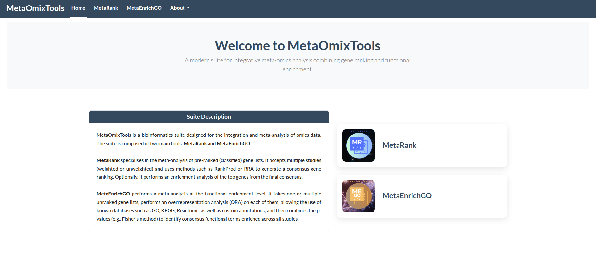
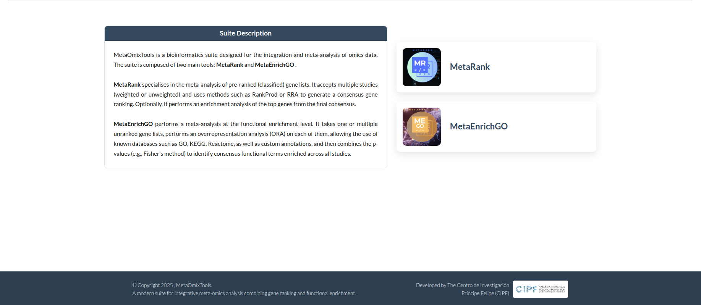

```{=html}
<style>
body {
  text-align: justify;
  font-size: 0.95em;
}
</style>
```

------------------------------------------------------------------------

The **MetaOmixTools** suite offers a unified web platform for meta-omics data integration and analysis. The top navigation bar includes four main entries, with an `About` dropdown containing supplementary resources:

1.  **Home**
2.  **MetaRank**
3.  **MetaEnrichGO**
4.  **About**
    -   Instructions
    -   Contacts
    -   Gallery
    -   GitHub

<br>

## Home

The **Home** page serves as the main landing section for *MetaOmixTools*, providing:

-   **General Overview**: A concise panel introducing the purpose and scope of *MetaOmixTools*. It highlights the platform’s role in simplifying multi-study omics analysis and includes brief individual descriptions of each available tool.

-   **Tool Access Buttons**: This section features two buttons — one for *MetaRank* and another for *MetaEnrichGO*. Each tool is represented by a logo and name, which is an access button that links directly to its user interface.

{fig-align="center"}

<p style="text-align: center; font-style: italic; color: #666; margin-top: 5px;">Figure 1: MetaOmixTools Home Interface. Landing page displaying the general platform overview and direct access portals for the MetaRank and MetaEnrichGO modules.</p>

-   **Footer**: This section indicates the year of creation and the responsible entity, along with an image that redirects to the official website of that organisation.

{fig-align="center"}

<p style="text-align: center; font-style: italic; color: #666; margin-top: 5px;">Figure 2: MetaOmixTools Page Footer. Bottom section of the interface displaying the copyright year, the responsible entity, and a redirection link to the official website.</p>

<br>

## MetaRank

The **MetaRank** section loads the *MetaRank* tool, which enables consensus ranking of genes from multiple ordered gene lists derived from different studies or technologies.

-   **Input**: Accepts gene lists through file upload (`.tsv`, `.csv`, `.txt`) or direct paste into a text area.
-   **Meta-analysis algorithms**: Offers both weighted and unweighted ranking methods, including *RankProd* and *RobustRankAggreg*.
-   **Filters**: Allows customization of gene inclusion criteria, such the minimum number of occurrences in lists and missing value management. Additionally, it enables the application of enrichment analysis to the full consensus gene list resulting from the meta-analysis.
-   **Output**: Provides downloadable results including ranked tables in `.csv` or `.tsv` formats and graphical summaries in `.png`, `.jpg` or `.html` formats.

------------------------------------------------------------------------

<p>*For more information or detailed usage instructions, go to* [*`About → Instructions → MetaRank`*]{style="color:darkblue; text-decoration:underline;"}.</p>

<br>

## MetaEnrichGO

The **MetaEnrichGO** section gives access to functional enrichment analysis based on user-supplied lists derived from different studies or technologies.

-   **Input**: Supports only `.txt` format, either uploaded or pasted.
-   **Ontology options**: Includes Gene Ontology terms or custom annotation inputs via `TERM2GENE` and `TERM2NAME` tables.
-   **Parameters**: Users can adjust the enrichment parameters, such as the organism, the minimum number of occurrences in lists or the database used, since in addition to *GO*, it is possible to use *KEGG*, *Reactome* or even custom annotations.
-   **Output**: Provides downloadable results of enrichment tables in `.csv` or `.tsv` formats and graphical summaries in `.png`, `.jpg` or `.html` formats.

------------------------------------------------------------------------

<p>*For more information or detailed usage instructions, go to* [*`About → Instructions → MetaEnrichGO`*]{style="color:darkblue; text-decoration:underline;"}.</p>

<br>

## About

The `About` dropdown provides essential support and additional materials to enhance user experience:

### Instructions

Comprehensive documentation for every section of the suite:

-   **Overview**: This page, outlining the general navigation, layout, and primary components of *MetaOmixTools*.
-   **MetaRank**: A complete guide including data preparation, choice of algorithm, parameter settings and exploration of the results, as well as recommendations for use or error correction.
-   **MetaRank practical examples**: The presentation of 3 examples of use to address all the possibilities offered by the tool. One example is of basic use, the second of full use and the third of advanced use, alternating the input possibilities.
-   **MetaEnrichGO**: Detailed steps for enrichment analysis, covering ontology selection, parameter configuration, output interpretation, and sample workflows as well as recommendations for use or error correction.
-   **MetaEnrichGO practical examples**: The presentation of 2 examples of use to address all the possibilities offered by the tool.

### Contacts

Direct channels for help and feedback:

-   **Development Team**: Email addresses for reporting issues, requesting support, and providing suggestions.
-   **FAQ**: Frequently Asked Questions addressing common troubleshooting topics, tips for data formatting, and best practices.

### Gallery

A curated showcase of typical outputs to illustrate the tools’ capabilities:

-   **Interface snapshots**: Screenshots demonstrating interactive features options.
-   **Consensus ranking visualizations**: *Heatmaps* and distribution plots generated by *MetaRank*. Examples of ranked tables and the top genes enrichment analisis as their Dot/Bar plot.
-   **Enrichment results**: *Dot plots*, bar charts, and summary tables from *MetaEnrichGO*.

### GitHub

The central hub for collaboration and code access:

-   **Repository**: Link to the *MetaOmixTools* GitHub page for source code, issue tracking, and community contributions.
